# Praktikum 5 — JavaScript	Dasar	dan	Manipulasi	HTML

## Identitas Praktikum

- **Nama:** Mu’ammar Kadafi
- **NIM:** 312510192
- **Program Studi/Semester:** Teknik Informatika / 3
- **Mata Kuliah:** Pemrograman Web
- **Dosen Pengampu:** Agung Nugroho, S.Kom., M.Kom.
- **Kelas:** I253C
- **Hari/Tanggal:** Sabtu, 25 Oktober 2026
- **Pertemuan:** 6 (Offline)

## Tujuan Praktikum

- Memahami sintaks dasar JavaScript dan cara menyisipkan JavaScript pada HTML.
- Menggunakan variabel, tipe data, operator, percabangan, perulangan, dan function.
- Menampilkan informasi melalui console, alert, prompt, dan elemen HTML.
- Memanipulasi konten serta gaya elemen HTML menggunakan JavaScript.
- Membuat interaksi sederhana pada form dan melakukan validasi input.
- Mendokumentasikan pekerjaan praktikum beserta hasil pengujiannya.

## Langkah-Langkah Praktikum

### 1. Mempersiapkan Text Editor

Mempersiapkan text editor yang akan digunakan untuk menulis kode program, misalnya Visual Studio Code.

### 2. Membuat Folder Kerja

Membuat folder kerja dengan nama `lab5_javascript` sebagai tempat menyimpan file praktikum.

### 3. Membuat File

Membuat file baru dengan nama `index.html` dan `script.js` di dalam folder kerja yang telah dibuat.

### 4. Menuliskan Kode HTML

Pada file `index.html`, masukkan kode berikut.

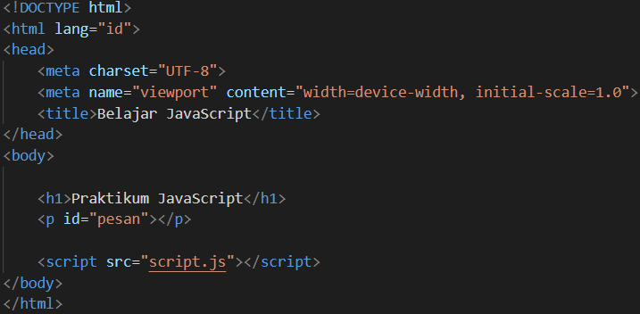

### 5. Menuliskan Kode JavaScript

Pada file `script.js`, masukkan kode berikut.

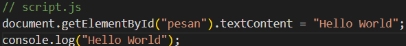

Buka file index.html, kemudian jalankan halaman tersebut di browser. Setelah halaman terbuka, klik kanan pada halaman, pilih Inspect, lalu buka tab Console untuk melihat hasil eksekusi JavaScript. Tampilan akan terlihat seperti pada gambar berikut.

Tampilan akan terlihat seperti pada gambar berikut.

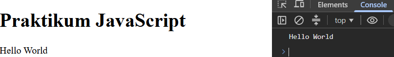

Perbedaan antara tulisan “Hello World” yang tampil pada halaman browser dan Console terletak pada perintah JavaScript yang digunakan. Tulisan yang muncul pada halaman browser berasal dari perintah document.getElementById("pesan").textContent = "Hello World";.  Perintah tersebut digunakan untuk mencari elemen HTML dengan atribut id="pesan", kemudian mengubah isi teksnya menjadi “Hello World”. Sementara itu, tulisan yang muncul pada Console berasal dari perintah console.log("Hello World");, yang digunakan untuk menampilkan pesan pada Console browser. Perintah ini dapat membantu memeriksa hasil eksekusi kode dan melakukan debugging selama proses pengembangan 
program JavaScript.

### 6. Alert dan prompt 

Buka file `script.js`, isi denga kode berikut. 

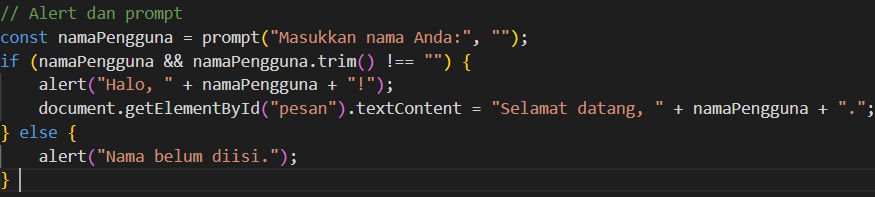

Tampilan akan terlihat seperti pada gambar berikut. 

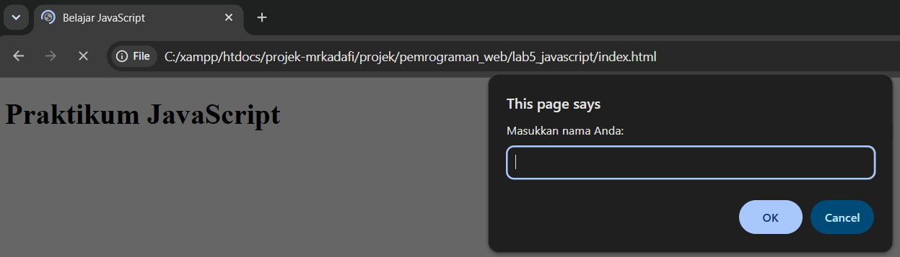

Tampilan setelah memasukkan nama seperti gambar berikut.

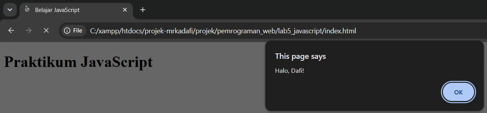

Tampilan setelah menekan ok seperti gambar berikut.

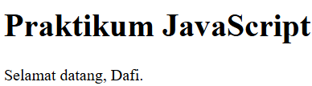

Tampilan setelah menekan cancel seperti gambar berikut.

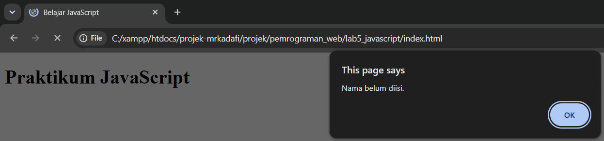

Tampilan setelah menekan ok dengan membiarkan input kosong seperti gambar berikut.

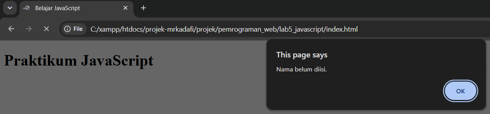

### 7. Function dan operasi aritmetika

Buat function yang menerima bilangan, lalu menampilkan hasil penjumlahan, pengurangan, perkalian, pembagian, dan sisa bagi.

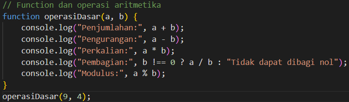

Tampilan akan terlihat seperti pada gambar berikut.

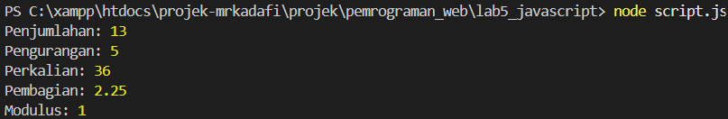

### 8.  Seleksi kondisi if–else

Buat program yang meminta nilai melalui prompt. Nilai minimal 60 dinyatakan lulus. Perhatikan bahwa prompt menghasilkan string sehingga masukan numerik perlu dikonversi.

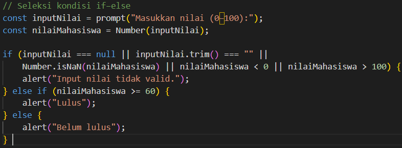

Tampilan akan terlihat seperti pada gambar berikut.

Tampilan setelah menekan ok dengan membiarkan input kosong dan menekan cancel seperti gambar berikut.

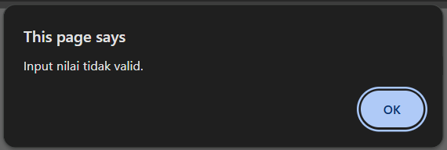

Tampilan setelah input nilai kurang dari 60 seperti gambar berikut.

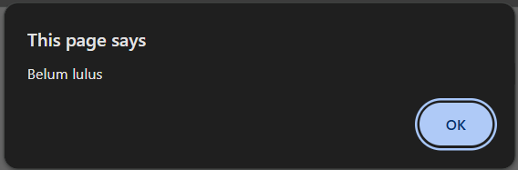

Tampilan setelah input nilai di atas 59 seperti gambar berikut.

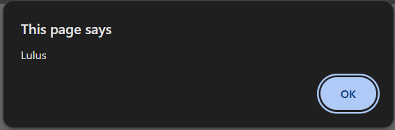

### 9.  Seleksi kondisi switch

Kemudian buat minta pengguna memasukkan angka 1–5 dan tampilkan nama bilangan menggunakan switch.

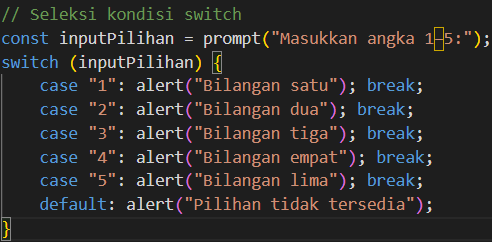

Tampilan akan terlihat seperti pada gambar berikut.

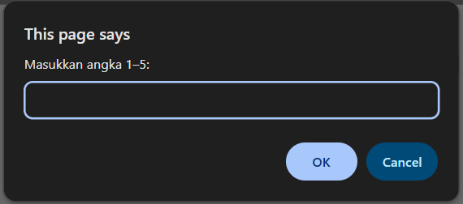

Tampilan setelah menekan ok dengan membiarkan input kosong dan menekan cancel seperti gambar berikut.

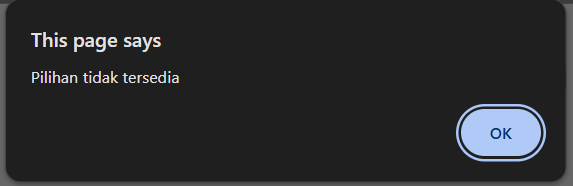

Tampilan setelah input bilangan seperti gambar berikut. 

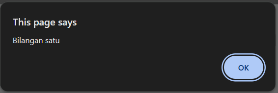

### 10.  Form bilangan genap atau ganjil

Tambahkan form berikut pada body index.html. Saat tombol ditekan, program memeriksa bilangan dan menampilkan apakah bilangan genap atau ganjil. 

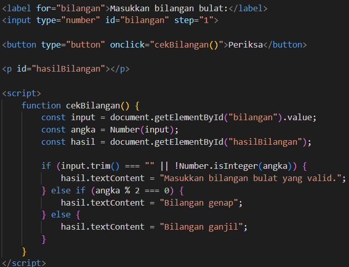

Tampilan setelah input angka positif seperti gambar berikut.

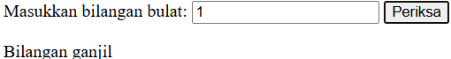

Tampilan setelah input angka negatif seperti gambar berikut.

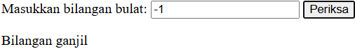

Tampilan setelah input angka nol seperti gambar berikut.

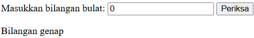

Tampilan setelah input angka desimal seperti gambar berikut.

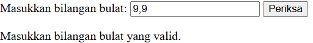

Tampilan setelah input kosong seperti gambar berikut.

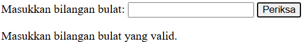

### 11.  Mengubah warna halaman

Buat tiga tombol yang mengubah warna latar halaman. Gunakan satu function dengan parameter agar kode tidak berulang. 

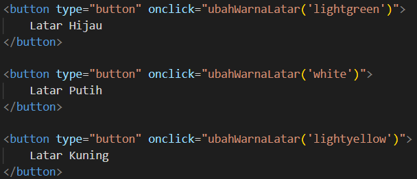

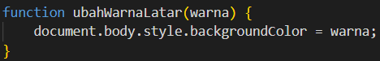

Tampilan akan terlihat seperti pada gambar berikut.

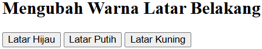

Tampilan setelah menekan latar hijau seperti pada gambar berikut.

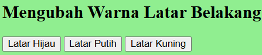

Tampilan setelah menekan latar putih seperti pada gambar berikut.

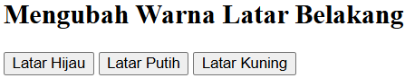

Tampilan setelah menekan latar kuning seperti pada gambar berikut.

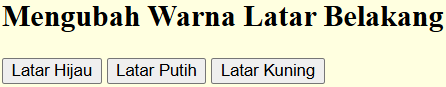

### 12.  DOM dan checkbox menu makanan

Buat daftar menu menggunakan checkbox. Total harga berubah otomatis ketika pilihan dicentang atau dilepas. 

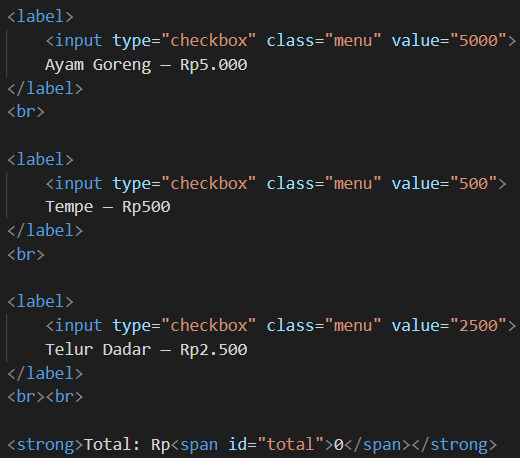

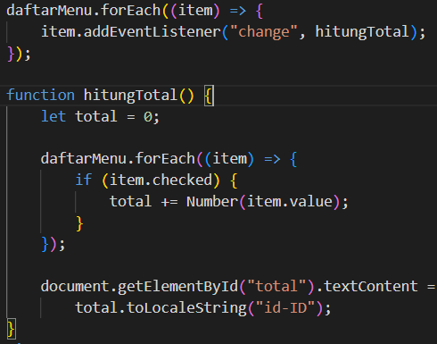

Tampilan akan terlihat seperti pada gambar berikut.

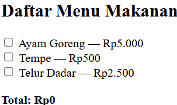

Tampilan setelah centang box seperti pada gambar berikut.

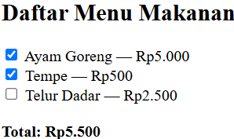
